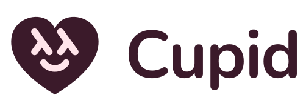

<p align="center">
  <picture>
    <source media="(prefers-color-scheme: dark)" srcset="assets/logo-wordmark-dark.svg">
    
  </picture>
</p>

<p align="center">
  <strong>Hugs, revived.</strong><br>
  <em>A small Haskell interpreter in plain C, with modern base, that
  builds in a minute.</em>
</p>

---

Cupid is Hugs 98 brought back.  Hugs is the interpreter Mark P Jones
started in 1994, and the Haskell many people learned with.  A group of
volunteers kept it going until the September 2006 release, the last one
that shipped, and in time it stopped building on current compilers.
Cupid picks up from that release:

- **A small interpreter in plain C.**  Source text is compiled to the
  code of a small abstract machine and run in the same process.  The
  whole interpreter is under fifty thousand lines of standard C23.
- **Modern base.**  The libraries follow GHC's base, roughly version
  4.18, so the Haskell written today loads.
- **Builds in a minute.**  You need a C compiler, meson, ninja, python3
  and bison, but no Haskell compiler.  It builds natively on Linux,
  macOS and Windows.

## Written to be read

The aim behind it is one sentence: **a Haskell implementation you can
sit down and read.**  Not the fastest one, not the most complete one.
The one where you can follow an expression from the characters you
typed to the value that comes back, and never lose the thread.  It
isn't there yet: much of the C is still Hugs's, tidied rather than
rewritten.  But every change is judged against that aim.

Three things follow from it, and they don't change:

- **It is an interpreter written in C.**  Source text is compiled to the
  code of a small abstract machine and run in the same process.  No
  native code generation, no linker, no separate compilation step.
- **It does not self-host.**  Nothing in the implementation is written in
  Haskell except the libraries it ships.  You need a C compiler and a
  few build tools, but no Haskell compiler, and the thing you are
  reading is the thing that runs.
- **It stays small.**  The whole interpreter is under fifty thousand
  lines of C, and it is kept that way.  The libraries are Haskell, with
  a few small C helpers in `base`, and grow with what programs import;
  the interpreter's C grows only where a library can't do the job.
  Anything that doesn't serve the aim gets deleted rather than parked
  behind a flag.

That third one does most of the work.  A flag is a promise to keep two
code paths working forever, and a tree full of them is exactly the tree
you can't read.  So when something has to go, it goes.

## Where it's at

A fair amount of the 2006 tree has already gone: the autoconf build, the
flag-guarded extensions, the GHC/nhc98 shared library sources and the
three-stage bootstrap that turned them into something Hugs could load,
the platforms nobody has run this century.  None of that was deleted on
a whim: [The design of Cupid](docs/explanation/design.md) says what
stayed and why.  If you want the longer story of where the code came
from, that's [History](docs/explanation/history.md).

What has been added is what real code needs.  The libraries follow
GHC's base, roughly version 4.18, with `Applicative` under
`Monad`, `Semigroup` under `Monoid`, and `Foldable` and `Traversable`.
The transformers package loads from its unmodified source once it has
been through the C preprocessor; see
[Preprocess source files before loading](docs/how-to/preprocess-sources.md).
Running real code doesn't mean following GHC.  A feature gets in when
real code needs it, when it fits the one type checker with nothing below
the type checker changing, and when Cupid can take the common case and
reject the rest.  Every extension is always on, except overlapping
instances, which need the `+o` option.  Unboxed types, Template Haskell
and STM are out, and type families are undecided.
[Language extensions](docs/reference/extensions.md) lists what is
accepted and what is left out.

It builds and runs.  The code is standard C23 and builds with meson on
64-bit Linux, macOS, Windows and the BSDs.  Linux, macOS and Windows are
built and tested on every change; on Windows it builds natively with
MinGW-w64, see [Build Cupid on Windows](docs/install/build-on-windows.md).

## Quick start

You need a C compiler, meson 1.1 or later, ninja, python3 and bison.
Then:

```sh
CC=gcc meson setup build
ninja -C build
CUPIDDIR=build/libraries/cupiddir build/src/cupid
```

```
Cupid> map (*2) [1..10]
[2,4,6,8,10,12,14,16,18,20]
Cupid> :quit
```

The whole build takes a minute or two and never writes to the source
tree.  Two things worth knowing up front:

- Name a **real** compiler in `$CC`.  meson bakes the command into
  `cupid`, which runs it at library-build time and again at run time
  to compile the C stubs of modules with foreign imports.  A wrapper like
  `sccache cc` breaks that step even when the C sources compiled fine;
  the symptom is `cupid --ffi` reporting "Error while running compilation
  command".
- meson remembers the compiler it found, so changing it in an existing
  build directory needs `meson setup --wipe build`.  A plain
  `--reconfigure` keeps the old one.

Tests are `meson test -C build`, and installing is `ninja -C build
install`.  [Build Cupid on Linux and macOS](docs/install/build-on-linux-and-macos.md)
has the detail, and [Build options and install
layout](docs/reference/build-options.md) lists every `-Dname=value` you
can set.

## Documentation

The docs follow [Diátaxis](https://diataxis.fr/), so where a page lives
tells you what it's for.  [docs/README.md](docs/README.md) is the index;
the useful starting points are:

- [Getting started with Cupid](docs/tutorials/getting-started.md) — a
  first session, from build to running a program.  About 20 minutes.
- [How Cupid runs a program](docs/explanation/how-cupid-runs-a-program.md)
  — source text to abstract machine, and where each piece lives.  Read
  this before the source.
- [Interpreter commands](docs/reference/commands.md) and
  [Options](docs/reference/options.md) — what you can type at the prompt
  and what you can set.
- [The language Cupid accepts](docs/reference/language.md) — Haskell 2010
  conformance, and the deviations and bugs that are known.
- [Call C functions from Haskell](docs/how-to/call-c-functions.md) — the
  FFI and `cupid --ffi`.
- [The design of Cupid](docs/explanation/design.md) — why the tree
  looks the way it does.
- [Differences from Hugs 98](docs/reference/differences-from-hugs.md)
  — what changed, if you used Hugs.

## Layout

- `src/` — the interpreter: lexer, parser (`parser.y`), type checker,
  bytecode compiler, evaluator, storage, and the `cupid` front end,
  which shows the prompt, runs a program or compiles foreign-import
  stubs
- `libraries/` — the Haskell it ships: `cupid` (`Cupid.Prelude`, where
  most of the Prelude is defined, and the interpreter-specific `Cupid.*`
  modules) and `base` (the `Prelude` module and the rest of base, with a
  few C helpers in `cbits`).  `libraries/tools/` holds the build script
  and the generator for `Cupid.SysConfig`
- `docs/` — tutorial, how-to guides, reference, explanation and the
  manual page
- `tests/` — the regression tests and the script that runs them
- `demos/` — example programs, installed alongside the libraries
- `www/` — the website, a [Zola](https://www.getzola.org/) site that
  builds from `docs/`

Add a test for every bug you fix.  Each `tests/NAME.hs` is a program
whose output is compared with `NAME.stdout`, or an interpreter session
when `NAME.stdin` exists; the comment at the top of `tests/run-tests`
describes the rest.

## About the name

It's a fork of Hugs, so it needed a name in the same family.  Hugs was
first released on Valentine's Day, 14 February 1995, which made Cupid
the obvious choice.  The grin on the logo is his: Cupid has always been
a bit of a troublemaker.

## Author, origin and licence

Cupid is written and maintained by [Andrea Bedini](https://github.com/andreabedini).

It is derived from Hugs 98, which is Copyright (c) Mark P Jones,
Alastair Reid, the Yale Haskell Group, and the OGI School of Science &
Engineering at OHSU, 1994-2005, and distributed under the BSD-style
licence in [License](License).  Cupid is distributed under the same
licence.  The `base` library carries its own BSD-style licence, in
[libraries/base/LICENSE](libraries/base/LICENSE), because it is derived
from code by the GHC project, the Haskell 98 Report and the Haskell FFI
specification.

The people who built Hugs 98 are listed in [Credits](Credits).  The type
checker and the abstract machine are their design, and the libraries
grew from theirs; this tree would not exist without their work.
